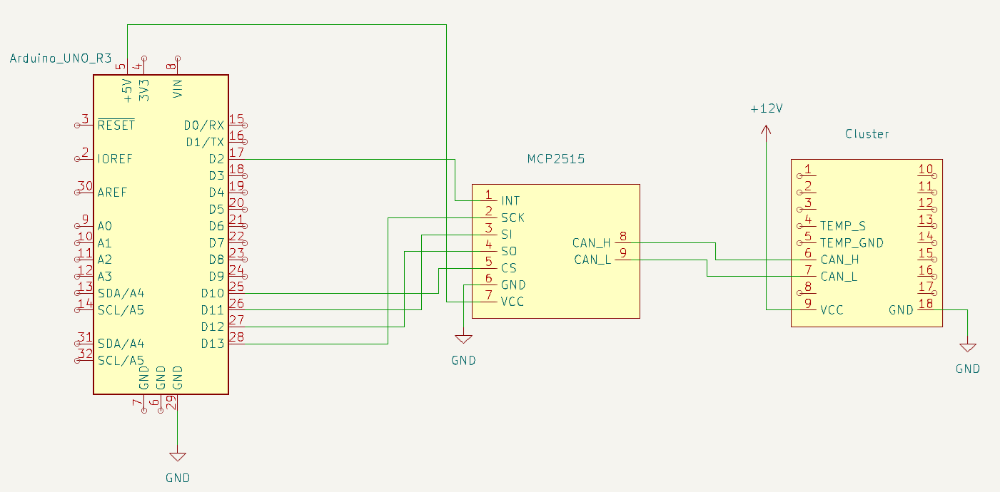

# Arduino CAN Cluster

This project integrates Arduino Uno, a CAN module, and a BMW E90 car dashboard to visualize game data using the SimHub application.

---

## Table of Contents

1. [Project Description](#project-description)
2. [Requirements](#requirements)
3. [Tested Hardware](#tested-hardware)
4. [Installation](#installation)
5. [ESP32 Version (Bluetooth)](#esp32-version-bluetooth)
6. [Usage](#usage)
7. [Features](#features)
8. [License](#license)
9. [Contact](#contact)

---

## Project Description

* The project allows reading game data and displaying it on a physical BMW E90 car dashboard.
* Uses Arduino Uno as the control unit, a module based on the MCP2515, and the SimHub application for configuration and data transfer.
* Includes Arduino code and a SimHub configuration file.
* Can be part of a driving simulator or an educational platform for learning CAN Bus.

---

## Requirements

* Arduino Uno
* CAN Bus module (e.g., MCP2515)
* CAN Bus-compatible car dashboard
* Software:

  * Arduino IDE to upload code to Arduino
  * SimHub application for configuration and data transfer
* Project files:

  * Arduino code (`.ino` file)
  * SimHub configuration (`.shsds` file)

---

## Tested Hardware

The project has been tested only with the following setup:

* BMW E90 instrument cluster, petrol version, US market:
  * speedometer in mph (with km/h inner scale), odometer in miles
  * fuel gauge and mpg consumption gauge
  * most likely from a car with manual gearbox - it does not show the P/R/N/D gear display
* Arduino Uno and ESP32 DevKit (classic ESP32 with Bluetooth Classic)
* MCP2515 CAN module with 8 MHz crystal and TJA1050 transceiver
* Euro Truck Simulator 2 through SimHub

Other clusters (diesel, km/h, automatic gearbox, LCI, M3) may be coded differently or expect other frames, so some features (e.g., consumption gauge, check control IDs, cruise control display) may behave differently or not work at all.

---

## Installation

Step-by-step instructions to set up and run the project:

1. Clone the repository:

   ```bash
   git clone https://github.com/Adam-Sidor/CAN_Cluster
   ```
2. Upload the code to Arduino:

   * Open the `.ino` file in Arduino IDE.
   * Install the required libraries.

     * If you are using MCP2515 module and don't have the CAN library, copy the `CAN-0.3.1` folder into your Arduino libraries folder (on Windows usually in `Documents`).
   * Select the correct COM port and Arduino model.
   * Upload the code to the board.
3. Configure SimHub:

   * Open the SimHub application.
   * Create a new device under `Custom serial devices`.
   * Import the project configuration file using `Import settings`.
   * Configure the connection with Arduino under `Serial settings`.
4. Connect the hardware:

   * Connect the CAN module to Arduino and the car dashboard.
   * Connect power `+12V` and ground to all boards.
   * Connect Arduino via USB cable.
   * To remove the low ambient temperature message, add a resistor with appropriate resistance, e.g., `6 kΩ`. The temperature on the dashboard depends on the chosen resistor. With this value, the displayed temperature is about 18 ℃.
   * Wiring diagram:
     

---

## ESP32 Version (Bluetooth)

The `CAN_Cluster_ESP32` folder contains a version for ESP32 that receives data from SimHub wirelessly over Bluetooth (SPP serial port) and talks to the dashboard through the same MCP2515 module.

* Requires the classic **ESP32** (e.g., ESP32-WROOM / DevKit V1). ESP32-S2/S3/C3/C6 chips do not support Bluetooth Classic.
* The MCP2515 driver is included in the sketch folder - the `CAN-0.3.1` library is not needed (on ESP32 it uses the built-in controller instead of MCP2515).
* Wiring the MCP2515 module to ESP32:

  | MCP2515 | ESP32 |
  |---|---|
  | VCC | 5V (VIN) |
  | GND | GND |
  | CS | GPIO5 |
  | SCK | GPIO18 |
  | SI (MOSI) | GPIO23 |
  | SO (MISO) | GPIO19 through a voltage divider (e.g., 1 kΩ from the module, 2 kΩ to GND) |
  | INT | not connected (only used for receiving) |

  The module must be powered from 5 V (required by the TJA1050 transceiver). 3.3 V signals from ESP32 are at the edge of the MCP2515 input threshold when it runs at 5 V - it usually works, but if the serial monitor shows `Connecting with CAN failed!`, check the wiring and the MISO divider.
* Check control messages and warning lights (also in the Uno version) are sent in CAN frame `0x592`. The `ccOn<ID>` / `ccOff<ID>` commands turn a message on/off (active ones are repeated every second, otherwise the cluster drops them). The SimHub configuration maps ETS2/ATS warnings:

  | Game warning | CC-ID |
  |---|---|
  | Low fuel | 275 |
  | AdBlue | 643 |
  | Oil pressure | 212 |
  | Water temperature | 39 |
  | Battery voltage | 213 |
  | Air pressure | 308 |
  | Wheels damage ≥ 10 % | 50 (tyre pressure) |
  | Chassis damage ≥ 10 % | 34 (check engine) |
  | Chassis damage ≥ 30 % | 21 |
  | Cargo damage ≥ 10 % | 169 (yellow exclamation mark) |
  | Trailer chassis damage ≥ 10 % | 19 (boot open) |

  Forza Horizon 5 (`CurrentGame` = `FH5`) has no launch control in its telemetry, so it is detected from the inputs: speed < 5 km/h, throttle > 90 % and handbrake pulled light CC-ID 446 (checkered flag). FH5 also sends no lights, so the dashboard backlight is kept on as with parking lights.

  Other IDs tested on the cluster: 28 (oil level), 166 (coolant level), 169 (yellow exclamation mark). The cluster confirms a shown message in frame `0x338` (visible with `DEBUG_CAN_RX`). The "!" service reminder (CC-ID 281) shown after every ignition on is turned off continuously (`SUPPRESS_SERVICE_LIGHT`). IDs come from [veikkos/e90-can-cluster](https://github.com/veikkos/e90-can-cluster).
* Fuel consumption (`fuelRate<µl/s>`, also in the Uno version) is sent as total injected fuel in the engine data frame `0x1D0`, the cluster computes the consumption gauge from it. The gauge works only together with DME status `0x12F` and vehicle speed from DSC `0x1A0`, which are sent as well. In the SimHub configuration it is divided by 3, so truck consumption fits the car gauge - remove `/ 3` for cars.
* After uploading the code, pair the computer with the `CAN_Cluster` device. Windows will create a COM port (Bluetooth, outgoing) - select it under `Serial settings` in SimHub. The SimHub configuration is the same as for Arduino.
* When Bluetooth disconnects, the speedometer and tachometer drop to zero.
* Debugging tools (USB serial monitor, 115200 baud, line ending `Newline`):

  * With `DEBUG_CAN_RX` enabled, frames sent by the cluster itself are printed as `CAN< ID [length] data`. Each ID is printed at most once per 2 s, `0x338` (check control messages) also on every change. Requires the MISO line to be connected.
  * The `can<ID>:<data>[x<count>]` command (ID and data in hex) sends any frame to the cluster, e.g. `can592:401F0031FFFFFFFF` sends it once (check engine message on) and `can592:401F0031FFFFFFFFx20` 20 times every 100 ms; `x0` stops a repeated frame. It works over Bluetooth too and is meant for finding unknown frames.

---

## Usage

1. Start Arduino and ensure the device is correctly connected.
2. Configure SimHub to read data from the selected game and communicate with Arduino.
3. Observe real-time data on the car dashboard.

---

## Features

Some features may not work depending on the game!

* Integration with SimHub.
* Data visualization on the car dashboard:

  * Speedometer
  * Tachometer
  * Fuel gauge (may require pressing the Arduino RESET button)
  * Clock displaying computer system time
  * Handbrake indicator
  * Turn signals and hazard lights
  * Truck warnings (low fuel, AdBlue, oil pressure, water temperature, battery, air pressure) and damage as check control messages (ETS2/ATS)
  * Fuel consumption gauge
  * Cruise control set speed shown on the display while cruise is active (ETS2/ATS; km/h shown as mph 1:1) - this also removes the cruise control error shown after power-up
  * Lights:

    * Parking lights
    * Low beam (front fog light indicator)
    * High beam
    * Warning lights (rear fog light indicator)
    * Dashboard backlight according to active lights
  * Temperature indicator (fixed value depending on resistor selected during [Installation](#installation))

---

## License

All rights reserved. The project is provided for demonstration and educational purposes only.

* You may use this project for personal and educational purposes.
* Commercial use or redistribution of the project in whole or in part requires explicit written consent from the author.

---

## Contact

* Author: Adam Sidor
* Email: [sidoadsi1@gmail.com](mailto:sidoadsi1@gmail.com)
